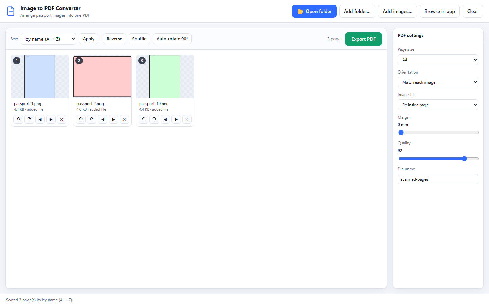
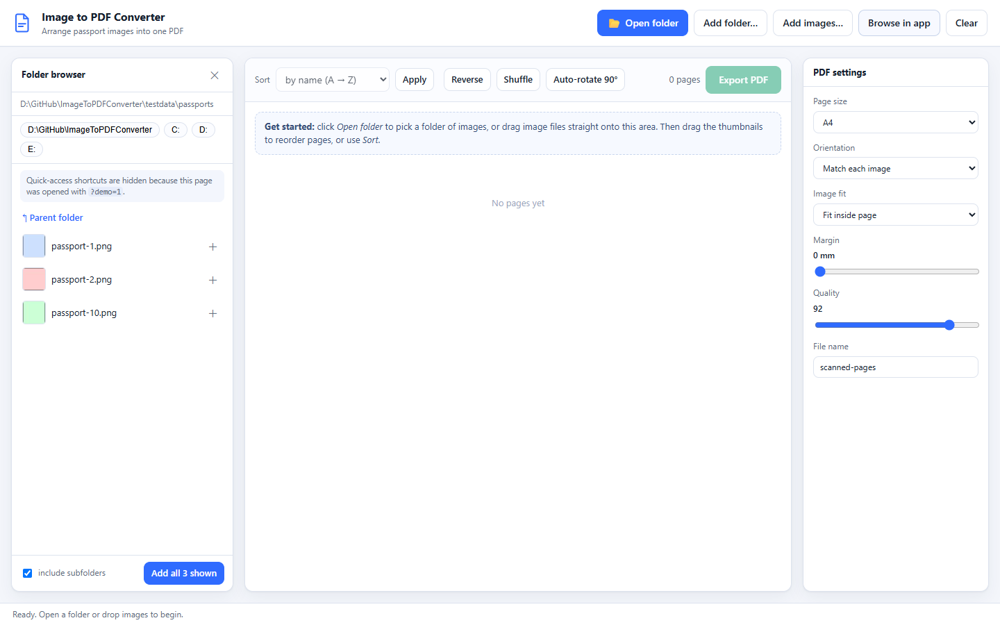
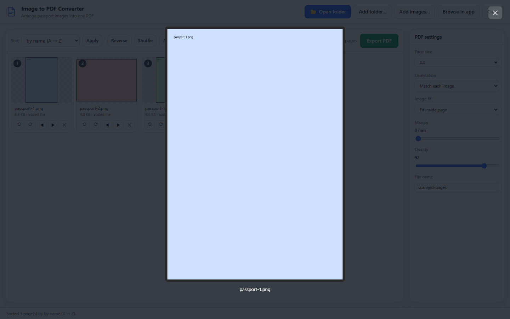

# Image to PDF Converter

[](https://github.com/Chunde/ImageToPDFConverter/actions/workflows/ci.yml)
[](LICENSE)
[](https://www.python.org/downloads/)

A small local web app that turns a folder — or a hand-picked set — of images
into **one PDF**, where *you* decide the page order. Sort by filename, or drag
the thumbnails around until they read the way you want.

Built for things like passport and ID scans, where page order matters and
getting it wrong means printing the whole thing again.



## Why another image-to-PDF tool

Most converters take your files, sort them however they feel like, and hand you a
PDF. If the order is wrong you cannot fix it — you rename files and start over.
This one shows you every page as a thumbnail and lets you rearrange them directly:

* **Reorder by dragging.** Drop a card onto another and a blue bar shows where it
  will land. The order you see is the order in the PDF.
* **Sort naturally.** `page2` sorts before `page10`, because numeric runs are
  compared as numbers.
* **Fix rotation per page** for those scans that came out sideways.
* **Nothing leaves your machine.** The server binds to `127.0.0.1` only, and
  images are read straight from disk — no upload to anyone's cloud.

## Quick start

```bash
git clone https://github.com/Chunde/ImageToPDFConverter.git
cd ImageToPDFConverter
python -m pip install -r requirements.txt
python run.py
```

Your browser opens at <http://127.0.0.1:8765/> (or the next free port; the exact
URL is printed). `Ctrl+C` in the terminal stops it.

On Windows you can also just double-click **`start.cmd`**, which checks for
Python, installs the two dependencies if they are missing, and launches the app.

**Requirements:** Python 3.10+ with [`Pillow`](https://python-pillow.org/) and
[`pypdf`](https://pypdf.readthedocs.io/). That is the entire dependency list —
the server is Python's standard library and the UI is plain HTML/CSS/JS with no
build step and no CDN.

## Getting images in

| How | What it does |
| --- | --- |
| **Open folder** | Native OS folder picker, then scans the folder recursively and adds every image it finds. |
| **Add folder…** | The browser's own directory picker. Works even where the native dialog cannot open, and keeps each file's subfolder in its name. |
| **Add images…** | The browser's multi-select file picker. |
| **Browse in app** | A sidebar browser with subfolder navigation, per-image `＋` buttons, and *Add all N shown*. |
| **Drag & drop** | Drop files from your file manager anywhere on the window. |

Supported formats: JPEG, PNG, WebP, BMP, TIFF, GIF, and HEIC/AVIF where a HEIF
plugin is installed. EXIF orientation is applied automatically and transparency
is flattened onto white, so phone photos and screenshots both come out upright.

## Changing the page order

* **Drag** a card onto another — the blue insertion bar shows the landing spot.
  Dragging switches the sort selector to `manual (drag order)`.
* **Sort** dropdown: by name (A→Z), name (Z→A), modified date, file size, or
  manual. Name sorting is natural, so `IMG_2` precedes `IMG_10`.
* **Reverse** / **Shuffle** for bulk edits.
* **◀ / ▶** on a card nudges a single page one slot at a time.
* **⟲ / ⟳** rotates one page by 90°.
* **Auto-rotate 90°** turns every landscape image into a portrait page in one
  click — handy when half the scans are sideways.
* **✕** removes a page, **Clear** empties the list.
* Click any thumbnail for a full-size preview (Esc closes it).

Sorting and dragging only ever change the order *in the app*. Your files are
never renamed, moved, or modified — the app only reads them.

## PDF settings

| Setting | Options |
| --- | --- |
| Page size | A4, Letter, A5, A3, or *Fit to each image* (page matches the image's own shape) |
| Orientation | match each image, force portrait, or force landscape |
| Image fit | fit inside page, fill page (crops), stretch to page, original size |
| Margin | 0–30 mm |
| Quality | JPEG quality inside the PDF (50–100) |
| File name | the name of the downloaded file |

Export downloads `<file name>.pdf`. Nothing changed since the last export? The
cached result is reused. Shortcuts: `Ctrl+O` open folder, `Ctrl+S` export.

<p align="center">
  
  
</p>

## How it works

```
run.py            launcher: dependency check, then serve
app/images.py     discovery (natural sort), decoding, EXIF orientation
app/pdfbuild.py   one image -> one page: geometry, fit, rotation
app/server.py     stdlib ThreadingHTTPServer: static UI + JSON API
web/              index.html, styles.css, app.js — no build step
tests/            smoke_test.py (pipeline), api_test.py (HTTP), ui_test.js (browser)
```

Pages are composited with Pillow at 96 dpi, written one page at a time with an
explicit `dpi` (so the physical page box is exact), then merged with pypdf.

### HTTP API

The UI is a thin client over a small JSON API, so you can script the app
directly — useful for batch-converting a shelf of scans.

| Endpoint | Purpose |
| --- | --- |
| `GET /api/health` | app info, browsable roots, native-picker availability |
| `GET /api/list?dir=&recursive=` | images in a folder |
| `GET /api/subfolders?dir=` | subfolders with image counts |
| `GET /api/thumb?path=&size=&rotation=` | cached JPEG thumbnail |
| `POST /api/pick-folder` | open the OS folder dialog |
| `POST /api/build` | `{items:[{path,rotation}], page:{...}, filename}` → PDF |
| `POST /api/build-multipart` | same, but with the image bytes uploaded |
| `POST /api/reset` | drop upload and thumbnail caches |

```bash
# Build a PDF from a folder, in filename order, A4 with a 6 mm margin
curl -s http://127.0.0.1:8765/api/list?dir=C:/scans > listing.json
# (build the items array from listing.json, then)
curl -s -X POST http://127.0.0.1:8765/api/build \
  -H 'Content-Type: application/json' \
  -d '{"filename":"scans","page":{"pageSize":"a4","marginMm":6},"items":[{"path":"C:/scans/01.jpg"}]}' \
  -o scans.pdf
```

The upload and translation cache lives in your system temp directory and is
dropped on exit or via `POST /api/reset`.

## Privacy and security

* Binds to `127.0.0.1` only — it is not reachable from your network.
* Reads the image paths you hand it; it never writes to, renames, or deletes your
  originals.
* The in-app browser lists folders by path, exactly as a file dialog would. It is
  a local tool: anyone who can reach the port can browse the same paths your
  account can read, which is why it is loopback-only.
* Opening the UI with `?demo=1` (`http://127.0.0.1:8765/?demo=1`) hides the
  personal quick-access shortcuts, so demos and screenshots do not show your home
  directory. That is how the screenshots above were taken.

## Tests

```bash
python tests/smoke_test.py          # pipeline: geometry, page order, rotation, margins
python tests/api_test.py            # HTTP API, both build paths, error handling

python run.py --no-browser &        # start the app first
node tests/ui_test.js               # browser: real drag-and-drop, sorting, export
node tests/screenshots.js           # regenerate the images in this README
```

`smoke_test.py` and `api_test.py` need only the runtime dependencies and generate
their own synthetic fixtures. `ui_test.js` drives the real page in a browser: it
adds images through the file input, performs genuine HTML5 drag-and-drop to
reorder them, and downloads a PDF to confirm the export matches. It needs
Playwright plus a Chromium/Edge build; point `PLAYWRIGHT_PATH` at a Playwright
module directory and `CHROME_PATH` at an installed `msedge.exe`/`chrome.exe` if
they are not resolvable by default.

CI runs the pipeline and API suites on Linux and Windows against Python 3.10 and
3.13 — see [`.github/workflows/ci.yml`](.github/workflows/ci.yml).

## Contributing

Issues and pull requests are welcome — see [CONTRIBUTING.md](CONTRIBUTING.md).
The whole app is about 1,200 lines, so it is easy to get your bearings.

## License

[MIT](LICENSE) © 2026 Chunde
